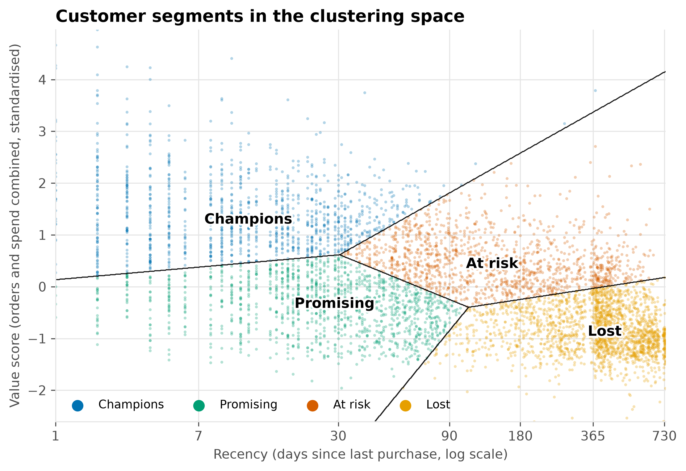
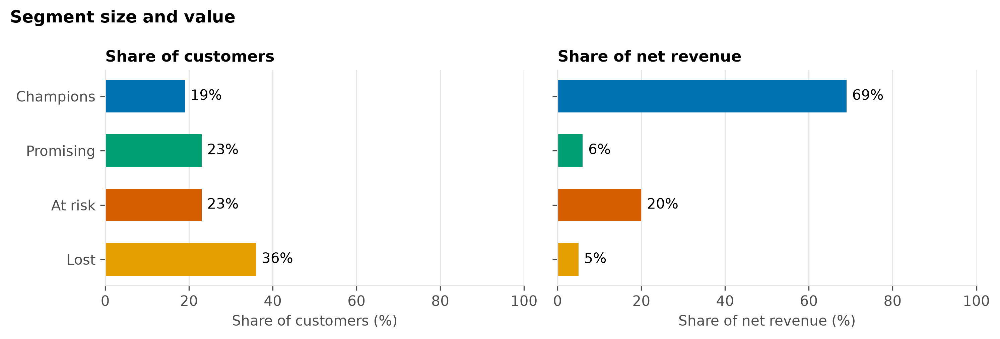
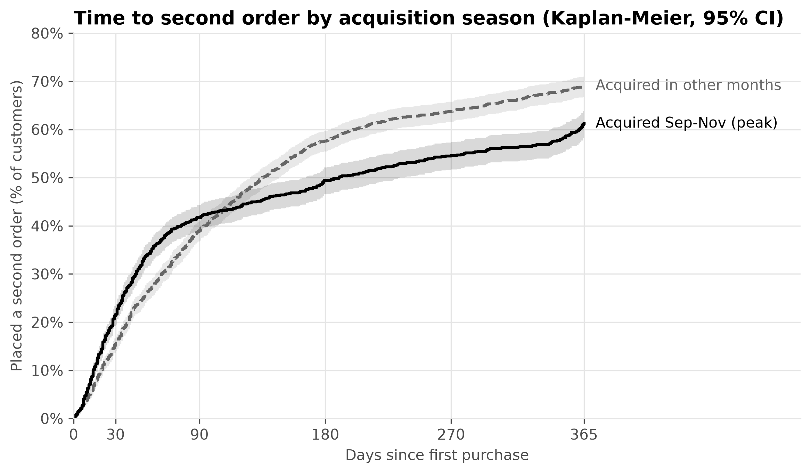
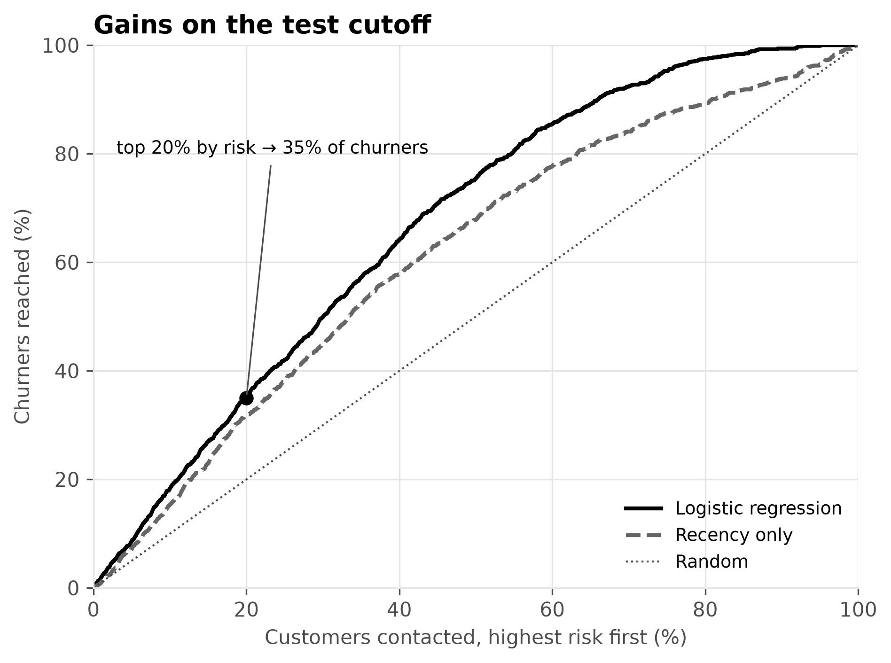

# Customer Segmentation & Retention Analysis

Who are the customers of an online giftware retailer, how well does it keep them, and which ones are about to leave?

**Data:** [Online Retail II](https://archive.ics.uci.edu/dataset/502/online+retail+ii) (UCI): transactions from a UK-based online retailer that sells giftware, many of them to wholesale customers. Dec 2009 – 9 Dec 2011.

**Status:** all four phases are done: cleaning and EDA (01), segmentation (02), cohort retention (03) and churn prediction (04).

## Key results

- **A few customers carry the business.** The top 20% of customers bring in about three quarters of net revenue. Champions are 19% of the customers and bring 69%.
- **A third of the customers are already lost.** Most of them placed one small order. They bring 5% of revenue.
- **Retention follows the calendar.** For clean new cohorts, about one in ten customers buys in January and one in four in November.
- **Customers acquired in the autumn peak are less likely to place a second order within a year.** The gap is about 8–12 points, and it rests on a single autumn.
- **A simple churn model ranks customers better than recency alone.** On a held-out test (June 2011), logistic regression reaches ROC-AUC 0.74 against 0.66 for recency. Gradient boosting did not beat it. "Churn" here means no purchase in the next 6 months, which is a lapse and not a permanent loss.
- **Ranking by risk × value protects more revenue.** Contacting the top 20% reaches about half of the value that churners represent, against about a tenth when ranking by risk alone. Today, Promising and At risk customers hold most of the expected sales at risk, next to a third in Champions.

## Approach

| # | Notebook | Method | Status |
|---|----------|--------|--------|
| 01 | [Data cleaning & EDA](notebooks/01_data_cleaning_eda.ipynb) | Remove the sheet overlap, duplicates, lines without a customer and non-goods charges. Match cancellations to sales. Explore seasonality, concentration and purchase gaps. | done |
| 02 | [RFM segmentation + K-Means](notebooks/02_rfm_segmentation.ipynb) | RFM table, log transform, K-Means on recency and a combined value score. k chosen by a stated criterion with bootstrap stability. Compared with rule-based RFM scores. | done |
| 03 | [Cohort retention](notebooks/03_cohort_retention.ipynb) | Retention by acquisition month on a balanced panel of cohorts. Kaplan-Meier for time to the second order, by acquisition season. Chance of returning after a silence, with a customer bootstrap. | done |
| 04 | [Churn prediction](notebooks/04_churn_prediction.ipynb) | Churn = no purchase in the next 6 months, a window chosen on purpose to keep more history. Features are built with `split_purchases(as_of=cutoff)`, so nothing after the cutoff leaks in. Temporal validation: 7 monthly training cutoffs in 2010, one test cutoff in June 2011. Logistic regression against gradient boosting, with a criterion fixed before running. Judged by ROC-AUC, PR-AUC, Brier score and calibration, not accuracy. | done |

## Customer segments

5,826 customers, grouped with K-Means (k = 4).



| Segment | Customers | Net revenue | Profile | Suggested action |
|---|---|---|---|---|
| Champions | 19% | 69% | Virtually all bought in the last 90 days, median 13 orders. | Protect them. Give them a named contact, early access to new ranges and fast issue handling. |
| Promising | 23% | 6% | Recent buyers with few orders (median 2). 41% placed their first order in the last 90 days. | Run a welcome series and push a second and third order. |
| At risk | 23% | 20% | Regular buyers, median 137 days since the last order. A third bought in the last 90 days. | Contact them before the autumn peak with a reorder reminder. Use the churn score from `04` to rank them. |
| Lost | 36% | 5% | Mostly one small order. 66% have not bought for over a year. | Low-cost win-back only, such as one email before the autumn peak. Do not spend much here. |



Notes on the method:

- The segments are regions of a continuum. The silhouette is moderate, so customers near a border could fall either way.
- The sharp edge near 365 days in the map is seasonal. Almost all customers whose last order was about a year ago bought in the 2010 Christmas peak and did not return.
- K-Means and rule-based RFM segments agree on the extremes and differ in the middle.

## Retention

Customers are grouped by the month of their first purchase. Comparisons use clean new cohorts, from April 2010 to November 2011. Time to a second order uses Kaplan-Meier, so customers who have not had time to return are not counted as lost.



- **Retention follows the calendar as much as customer age.** The share of new customers who buy goes from about one in ten in January to one in four in November.
- **Customers acquired in the autumn peak come back faster in the first month, then fall behind.** At 30 days, 21.6% have placed a second order, against 15.5% for other months. At 365 days it is 61.2% against 69.0%.
- **The one-year gap is about 8–12 points** (all clean cohorts, or 2010 only). The interval excludes zero in both. The log-rank test is not significant, because the curves cross.
- **After about 13–14 months of silence, customers rarely come back.** A small second wave appears around one year, from customers who reorder yearly.

## Churn model

**Question:** of the customers who bought in the last 6 months, which ones will not buy in the next 6 months?



- **The label is a lapse, not a permanent loss.** The 6-month window was a deliberate choice, to keep more history for the features. Notebook `03` pointed to about 12–13 months. The cost is real: a quarter to a third of the customers labelled as churned buy again in the following 6 months.
- **The model beats recency alone.** On the June 2011 test, ROC-AUC is 0.742 (95% CI 0.723–0.761) against 0.663 for recency. PR-AUC is 0.496 (0.46–0.533) against 0.419. The paired gains are 0.079 (0.057–0.100) and 0.077 (0.048–0.104). Gradient boosting did not meet the rule set in advance, so the simpler model was kept. Discrimination is moderate.
- **The probabilities are well calibrated on the test cutoff** (Brier score 0.179). Predicted and observed rates match in nearly every decile.
- **Ranking by risk alone reaches the most churners.** Contacting the top 20% reaches 35% of them. About 53% of the contacted customers lapse, against 30% at random.
- **Ranking by risk × value reaches the most value.** The top 20% reaches about 50% of the value churners represent. Risk alone reaches about 11%, and value alone about 34%. Risk × value reaches fewer churners (17%), and the value measure depends on a few very large customers. Value here is the last 6 months of sales, which is an assumption.
- **Drivers are one block of activity, not a ranking.** Buying in more months, placing more orders and buying more products go with lower risk. These measures overlap, so none adds much once the others are in. Recency raises the risk. The season shifts the risk for everyone. Cancellations and country show no effect. These are associations, not causes.
- **Today's scores, as a ranking.** 3,444 customers who bought in the 6 months up to 1 December 2011 are scored. The median risk is 18% for Champions, 57% for Promising, 59% for At risk and 70% for Lost (the few Lost customers who still bought recently). Champions still hold 34% of the expected sales at risk, and Promising and At risk 30% each. Read the scores as a ranking: calibration in winter was not tested.

## Business recommendations

The segment and retention items come from `02` and `03`. The churn items come from `04`. Items marked as hypotheses are not tested. Measure every campaign against a random hold-out group, because the model predicts who will lapse, not what will make them stay.

- **Champions:** keep them active. Give the 15 Champions in the two highest risk deciles a personal contact. Watch the share of Champions who still order within 90 days.
- **At risk:** start retention work here, because the revenue at stake is large and the customers are still reachable. Rank them by churn score and contact the top of the list first. Watch how many place an order within 90 days of being contacted, compared with the hold-out group.
- **Promising:** turn new customers into repeat customers. Offer a second order to those with a high churn score (hypothesis). Watch the share who place a second order.
- **Lost:** keep spending low. Watch the win-back rate against the cost of the campaign.
- **Choose the ranking by the goal:** use risk alone to keep as many customers as possible, and risk × value to protect revenue. Watch the revenue retained per contact.
- **Customers acquired in September–November (hypothesis):** an early second-order offer and a reactivation campaign before the next peak may lift their one-year return. The evidence is one autumn, so test it on a small group first. Watch the share who place a second order within 365 days.
- **Judge retention by calendar month:** compare a month with the same month of the previous year, not with the month before. Watch the share of acquired customers who buy in each calendar month.

## Limitations

- **Identified customers only.** 23% of the raw lines have no customer ID (15% of the gross sales revenue in the raw file, before removing the sheet overlap and duplicates) and are left out.
- **Wholesale-heavy customer base.** Some customers place very large orders, so spend and frequency are strongly skewed. The results may not hold for a retailer that sells mainly to consumers.
- **Two years of data.** The seasonal peak can only be seen twice. The one-year result for customers acquired in the peak rests on one autumn (2010).
- **Cohort caveats.** The December 2009 cohort is the existing customer base, not new customers. The January–March 2010 cohorts are partly existing customers, so they are left out of comparisons. December 2011 is left out as a partial month.
- **Long silences.** Estimates for silences of a year or more rest on gaps that started in 2009–10. They pool all seasons.
- **Snapshot segments.** Segments describe the end of the data. Newer customers have had less time to build frequency and spend, and many of them sit in Promising.
- **Churn label noise.** The 6-month window labels slow and yearly buyers as churned. A quarter to a third of the labelled churners buy again within the following 6 months.
- **One test cutoff.** The model was tested once, on 1 June 2011. Calibration in winter is untested, so today's scores (window December 2011 to May 2012, no autumn peak) are best read as a ranking.
- **Training data from 2010.** The model learned from one year, and its seasonal term rests on a few cutoffs.
- **Six months of feature history.** Longer-history features, such as tenure, were left out. The `02` segments use two years of history, so they partly repeat what the model sees.
- **Value is a proxy.** Value is the last 6 months of sales, and a few very large customers drive the risk × value result. For today's scores that window contains the autumn peak, so the expected sales at risk are overstated and are best read as relative sizes.
- **Customers without a segment.** A few of the scored customers (4 of 3,444) have a recent order but are not in `segments.parquet`, because the segments were built on customers with positive net revenue. They appear as "Not segmented" and do not change the percentages above.
- **Cleaning assumptions.** Exact duplicate lines are treated as system duplicates. The data cannot confirm this.

## Reproduce

Needs Python 3.12 or newer and Poetry.

```bash
poetry install
poetry run python -m ipykernel install --user --name customer-segmentation-retention   # once: the notebooks use this kernel
# download the dataset zip from UCI and unzip it into data/raw/ (expected file: online_retail_II.xlsx)
poetry run python -m src.make_dataset   # Excel -> data/interim/online_retail_II.parquet (reading the Excel takes minutes)
poetry run jupyter nbconvert --to notebook --execute --inplace notebooks/0*.ipynb   # runs 01 to 04 in order
poetry run pytest                       # run this last
```

- **Run order matters.** `01` writes `lines`, `transactions`, `adjustments` and `customers` to `data/processed/`; `02` reads them and writes `segments`; `03` reads `transactions`; `04` reads `lines` and `segments` and writes `churn_scores`.
- **Start notebooks from `notebooks/`.** They add the parent folder to `sys.path` with `Path.cwd().parent`. `nbconvert` does this for you; in Jupyter or VS Code, keep the working directory at `notebooks/`.
- **Run `pytest` after the notebooks.** The data-contract tests check the files in `data/processed/` and are skipped when they do not exist yet, so on a fresh clone a green run before the notebooks has not checked them.

## Project structure

```
├── data/
│   ├── raw/          # original Excel file (not tracked)
│   ├── interim/      # parquet copy of the raw data
│   └── processed/    # lines, transactions, adjustments, customers, segments, churn_scores
├── notebooks/        # 01 cleaning + EDA, 02 RFM + K-Means, 03 cohort retention, 04 churn prediction
├── reports/figures/  # charts saved by the notebooks
├── src/
│   ├── config.py        # paths and random state
│   ├── make_dataset.py  # Excel -> parquet
│   ├── cleaning.py      # cancellation matching (split_purchases)
│   ├── features.py      # RFM table and scores
│   ├── retention.py     # cohort activity, retention table, purchase intervals
│   ├── churn.py         # churn features and labels per cutoff
│   ├── plotting.py      # style, colours, save_fig
│   └── cvd_check.py     # colour-blindness check for figures
└── tests/            # pytest: cleaning, features, retention, churn, data contracts
```
